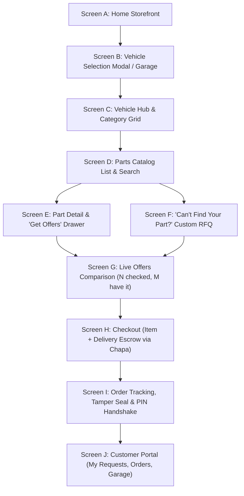

# TeraSync: Storefront and Catalog Specification

> **Parent Documents:** `PROJECT_CONTEXT.md` (overview and architecture) and `docs/BUSINESS_LOGIC.md` (detailed platform rules).  
> **Status:** Active Specification. If this document conflicts with older sections of `PROJECT_CONTEXT.md` or `docs/BUSINESS_LOGIC.md`, this document governs the customer storefront, vehicle catalog data model, vendor response workflow, and catalog-aware matching.

---

## 1. Product Change

The customer-facing experience transforms from a blank, form-only reverse-RFQ screen into a **vehicle-first spare parts catalog**.

### 1.1 Core Concept: Catalog vs. Inventory
- **Catalog of What Exists:** The catalog is a comprehensive, structured reference index of parts manufactured and engineered to fit specific vehicle variants. It communicates to the buyer: *"This part exists for your vehicle, here is its OEM reference, diagrams, aliases, and technical fitment notes."*
- **No Stock Quantities & No Public Prices:** The catalog is **NOT** a merchant inventory database and contains **NO fixed prices** and **NO "Add to Cart"** functionality. In Addis Ababa's informal spare parts hubs (Teklehaymanot, Kera, Somali Tera), merchants do not run barcode scanners or live ERP inventory feeds. Public prices would be inaccurate and encourage predatory broker markup.
- **On-Demand Price & Availability Discovery:** Real-time availability and prices come **strictly and privately from verified shops per individual request**.
- **Sealed Competitive Bidding:** When a customer requests offers for a catalog part, matching shops receive the request instantly. Shops confirm availability and price privately. Shops never see competing offers, other shops' prices, or how many offers have been submitted.

### 1.2 End-to-End Customer & Settlement Flow
1. **Vehicle Selection:** The customer selects their vehicle (e.g., *Toyota HiAce Minibus 5L Diesel*, *BYD Atto 3 EV*, or *Hyundai Tucson*), which is stored in session and saved to "My Garage".
2. **Catalog Browsing / Search:** The customer browses the vehicle-filtered category tree or searches by part name, Amharic synonym, local garage term, or OEM number.
3. **Select Part & Request Offers:** The customer picks a part (e.g., *Front Brake Caliper* or *EV Onboard Charger*). The request details (vehicle variant, catalog part, delivery location, urgency, and optional photo of the old part) are submitted.
4. **Automated Dispatch to Matching Shops:** The platform automatically notifies eligible, verified shops stocking that brand, model, and category in Addis Ababa.
5. **Private Shop Response:** Shops tap **AVAILABLE** (entering price in ETB, condition, warranty days, and a live shelf photo) or **NOT_AVAILABLE** (one tap).
6. **Customer Comparison:** The customer sees live aggregation: *"12 shops checked, 4 have it"*, reviews transparent offer cards (price, condition, warranty, shelf proof photo, shop rating), and accepts the best offer.
7. **Escrow Funding:** An order is created. The customer pays item price + delivery fee through Chapa (supporting Telebirr, CBE Birr, cards). Money is held securely in escrow.
8. **Tamper-Evident Delivery:** A courier picks up the part from the merchant, verifies physical condition and serials, attaches a numbered tamper seal, records photos, and delivers to the customer's garage.
9. **Physical Inspection & PIN Verification:** The buyer physically inspects the bolt pattern, connectors, and condition against the old part. Once satisfied, the buyer gives their secret 4-digit PIN to the courier.
10. **Settlement & Payout:** Courier enters the PIN into the app. Verification unlocks the escrow: platform keeps commission, the order is marked `COMPLETED`, and payout records are queued for the merchant and courier.

---

## 2. Launch Scope

The launch catalog focuses on high-volume passenger vehicles, commercial minibus taxis, and rapid-growth electric vehicles in Addis Ababa. All catalog entities are stored in administrative database tables and are editable via the Admin Portal—never hard-coded in application source code.

### 2.1 Launch Brands & Seed Models
- **BYD (Electric Vehicles / New Energy):**
  - *Seagull* (City EV Hatchback)
  - *Dolphin* (Compact EV Hatchback)
  - *Atto 3* (EV Compact SUV)
  - *Qin Plus* (EV / DM-i Sedan)
  - *Song Plus* (EV / DM-i SUV)
  - *Han* (Executive EV Sedan)
  - *Tang* (Mid-size EV SUV)
- **Toyota (Commercial & Passenger Fleet Backbone):**
  - *HiAce Minibus Taxi* (specifically the ubiquitous 5L 3.0L naturally aspirated diesel engine variant, RZH/LH series)
  - *Corolla* (Executive, European, and Middle-East specs; 1.6L / 1.8L)
  - *Vitz* (Compact hatchback; 1.0L / 1.3L)
  - *Hilux* (Single and double cab pickups; 1KD-FTV 3.0L / 2KD-FTV 2.5L / 1GD 2.8L)
  - *Land Cruiser Prado* (120 / 150 Series; 1KD / 1KZ / 1GR)
- **Hyundai (Passenger, Commercial & Taxi Segments):**
  - *i10 / Grand i10* (Entry-level compact taxi/private)
  - *Accent* (Popular sedan)
  - *Elantra* (Sedan fleet)
  - *Tucson* (Compact crossover)
  - *H-1* (Commercial transport / passenger van)

### 2.2 Category Architecture for Launch Fleet
- **EV-Specific Categories (BYD):**
  - High-Voltage Traction Battery Pack & Modules
  - Electric Drive Motor & Reducer Assembly
  - Motor Inverter / Controller (MCU)
  - Onboard Charger (OBC)
  - High-Voltage Charging Port (GB/T & CCS2 DC/AC ports)
  - High-Voltage to Low-Voltage DC-DC Converter
  - Electric Battery & Inverter Thermal Coolant Pump
  - Electric Air Conditioning Compressor (High-Voltage)
- **Mechanical & Diesel Categories (Toyota HiAce 5L & Commercial Fleet):**
  - Engine Mechanical (Cylinder Head, Block, Gaskets, Camshaft, Valves, Pistons)
  - Diesel Fuel System (5L Mechanical Injection Pump, Injector Nozzles, Primer Pump, Fuel Filter Housing)
  - Clutch & Drivetrain (Clutch Disc, Pressure Plate, Release Bearing, Master & Slave Cylinders)
  - Gearbox & Transmission (Manual 5-speed Gearsets, Synchronizers, Shift Bushings)
  - Suspension & Steering (Leaf Springs, Upper/Lower Ball Joints, Tie Rod Ends, Steering Box/Rack, Shock Absorbers)
  - Braking System (Front Brake Discs, Rear Brake Drums & Shoes, Wheel Cylinders, Tandem Master Cylinder, Load Sensing Proportioning Valve)
  - Cooling System (Copper/Brass Heavy-Duty Radiator, Water Pump, Thermostat, Fan Clutch, Radiator Shroud)

---

## 3. Catalog Data Model

The catalog serves as the single source of vehicle fitment and component metadata. Admin users manage all reference entities via the Admin Portal or through bulk CSV import.

### 3.1 Entity Schema Definitions

```prisma
model VehicleBrand {
  id        String         @id @default(uuid())
  name      String         @unique // e.g. "Toyota", "BYD", "Hyundai"
  slug      String         @unique // e.g. "toyota", "byd", "hyundai"
  logoUrl   String?
  isActive  Boolean        @default(true)
  createdAt DateTime       @default(now())
  updatedAt DateTime       @updatedAt
  models    VehicleModel[]

  @@map("vehicle_brands")
}

enum BodyType {
  SEDAN
  HATCHBACK
  SUV
  PICKUP
  MINIBUS
  VAN
}

enum FuelType {
  PETROL
  DIESEL
  HYBRID
  EV
}

model VehicleModel {
  id        String           @id @default(uuid())
  brandId   String
  brand     VehicleBrand     @relation(fields: [brandId], references: [id])
  name      String           // e.g. "HiAce", "Atto 3", "Tucson"
  slug      String           // e.g. "hiace", "atto-3", "tucson"
  bodyType  BodyType
  fuelType  FuelType
  imageUrl  String?
  isActive  Boolean          @default(true)
  createdAt DateTime         @default(now())
  updatedAt DateTime         @updatedAt
  variants  VehicleVariant[]

  @@unique([brandId, slug])
  @@map("vehicle_models")
}

model VehicleVariant {
  id           String          @id @default(uuid())
  modelId      String
  model        VehicleModel    @relation(fields: [modelId], references: [id])
  yearFrom     Int             // e.g. 1998
  yearTo       Int?            // null means current production
  engineCode   String          // e.g. "5L", "1KD-FTV", "TZ200XSQ"
  transmission String?         // e.g. "5-Speed Manual", "Single-Speed EV Reduction", "6-Speed Automatic"
  notes        String?         // e.g. "Addis taxi 15-seater configuration with rear leaf springs"
  isActive     Boolean         @default(true)
  createdAt    DateTime        @default(now())
  updatedAt    DateTime        @updatedAt
  fitments     PartFitment[]
  partRequests PartRequest[]
  savedInGarages SavedVehicle[]

  @@index([modelId])
  @@map("vehicle_variants")
}

model PartCategory {
  id          String         @id @default(uuid())
  parentId    String?
  parent      PartCategory?  @relation("CategoryHierarchy", fields: [parentId], references: [id])
  children    PartCategory[] @relation("CategoryHierarchy")
  nameEn      String         // e.g. "Inverter / Motor Controller"
  nameAm      String         // e.g. "ኢንቨርተር እና ሞተር መቆጣጠሪያ"
  slug        String         @unique
  iconUrl     String?
  sortOrder   Int            @default(0)
  evOnly      Boolean        @default(false)
  isActive    Boolean        @default(true)
  createdAt   DateTime       @default(now())
  updatedAt   DateTime       @updatedAt
  parts       CatalogPart[]

  @@map("part_categories")
}

enum SizeClass {
  SMALL   // Motorbike delivery (sensors, relays, brake pads, switches)
  MEDIUM  // Pickup delivery (alternators, starters, calipers, water pumps)
  LARGE   // Van / Light truck delivery (gearboxes, battery modules, leaf springs)
}

model CatalogPart {
  id             String        @id @default(uuid())
  categoryId     String
  category       PartCategory  @relation(fields: [categoryId], references: [id])
  nameEn         String        // e.g. "Diesel Fuel Injection Pump (5L)"
  nameAm         String        // e.g. "የናፍጣ ኢንጄክሽን ፓምፕ (5L)"
  description    String?       @db.Text
  images         String[]      // Reference diagrams and sample OEM photos
  oemPartNumbers String[]      // e.g. ["22100-5B300", "22100-5B301"]
  aliases        String[]      // Search synonyms: Amharic phonetics, local nicknames (e.g. "ማርሽ ቦምብ", "ፓምፕ")
  sizeClass      SizeClass     @default(MEDIUM)
  isActive       Boolean       @default(true)
  createdAt      DateTime      @default(now())
  updatedAt      DateTime      @updatedAt
  fitments       PartFitment[]
  partRequests   PartRequest[]

  @@index([categoryId])
  @@map("catalog_parts")
}

model PartFitment {
  id          String         @id @default(uuid())
  partId      String
  part        CatalogPart    @relation(fields: [partId], references: [id])
  variantId   String
  variant     VehicleVariant @relation(fields: [variantId], references: [id])
  fitmentNote String?        // e.g. "Fits LH114/LH166 chassis; verify 10mm mounting studs"
  createdAt   DateTime       @default(now())

  @@unique([partId, variantId])
  @@index([variantId])
  @@map("part_fitments")
}

model Banner {
  id        String   @id @default(uuid())
  title     String
  imageUrl  String
  linkUrl   String?
  sortOrder Int      @default(0)
  isActive  Boolean  @default(true)
  createdAt DateTime @default(now())
  updatedAt DateTime @updatedAt

  @@map("banners")
}

model SavedVehicle {
  id          String         @id @default(uuid())
  userId      String
  user        User           @relation(fields: [userId], references: [id])
  variantId   String
  variant     VehicleVariant @relation(fields: [variantId], references: [id])
  plateNumber String?        // e.g. "3-A49102 AA"
  nickname    String?        // e.g. "Bole Line Taxi #4"
  createdAt   DateTime       @default(now())
  updatedAt   DateTime       @updatedAt

  @@unique([userId, variantId, plateNumber])
  @@map("saved_vehicles")
}
```

### 3.2 Additions to Existing Core Entities

#### Changes to `PartRequest`
- `vehicleVariantId`: String (foreign key to `VehicleVariant`, replaces unvalidated loose text fields).
- `catalogPartId`: String? (foreign key to `CatalogPart`, nullable to allow custom unstructured requests).
- `isCustomRequest`: Boolean (default `false`; `true` when customer uses "Can't find your part?").
- `categoryId`: String (foreign key to `PartCategory`, replacing previous free-text category).
- Legacy fields (`make`, `model`, `year`, `engineModel`) remain populated for backwards-compatibility and logging, derived directly from the linked `VehicleVariant`.

#### Changes to `VendorProfile`
- `supportedBrands`: String[] (list of brand IDs or slugs the shop stocks, e.g. `["toyota", "byd"]`).
- `supportedModels`: String[] (optional filter; if empty, shop stocks all models of their supported brands).
- `partCategoryIds`: String[] (optional filter; if empty, shop receives all part categories for their brands).

### 3.3 Search Architecture
To accommodate Amharic script, English technical names, OEM part numbers, and colloquial phonetic spellings, search utilizes PostgreSQL full-text search combined with trigram similarity (`pg_trgm` extension):
- **Trigram Similarity GIN Index:** Created across `CatalogPart.nameEn`, `CatalogPart.nameAm`, `CatalogPart.aliases`, and `CatalogPart.oemPartNumbers`.
- **Typo Tolerance:** A query for *"Injektion"* matches *"Injection"*; a query for *"22100-5B30"* matches *"22100-5B300"*; an Amharic search for *"ማርሽ"* returns transmission components.

---

## 4. Customer Storefront UI

The customer storefront is designed mobile-first (optimized for 360px viewport width) while scaling gracefully to high-density desktop displays.

### 4.1 Page Layout Architecture
- **Header:**
  - Brand Logo (`TeraSync`).
  - Active Vehicle Selector Chip: Displays currently selected vehicle (e.g., `🚐 Toyota HiAce 5L Minibus`) with a prominent `[Change]` button.
  - Universal Search Bar: Full-width responsive input with placeholder *"Search part name, OEM number (e.g. 22100, alternator, ፍሬን)..."*
  - Language Toggle: Switcher between Amharic (`አማ`) and English (`EN`).
  - Notification Bell: Alert icon for active bid alerts and PIN delivery tracking.
  - Auth Action: Displays *"Sign In"* (or *"My Portal / Garage"* for logged-in users).
- **Left Sidebar / Drawer ("Shop All Categories"):**
  - Desktop: Vertical accordion and hover flyout displaying the `PartCategory` tree, automatically filtered to show only categories relevant to the selected vehicle (e.g., EV categories hidden for diesel HiAce).
  - Mobile: Slide-in navigation drawer accessed via hamburger icon.
- **Hero Carousel:**
  - Admin-managed visual banners highlighting escrow protection, verified shop networks in Teklehaymanot/Kera/Somali Tera, and seasonal maintenance alerts.
- **"Shop by Brand" Tile Grid:**
  - Prominent visual brand cards for launch brands: **BYD**, **Toyota**, and **Hyundai**. Tapping a brand immediately opens its model selection drawer.
- **Circular Category Shortcut Tiles:**
  - Quick-access icons: *Brakes*, *Suspension*, *Filters*, *Lighting*, *Body Parts*, *Electrical*, *EV Powertrain*.
- **"Popular Parts for Your Vehicle":**
  - Horizontal swipeable / wrap product cards filtered by the active vehicle.
  - **Product Card Content:** Image/diagram, Part Name (EN & AM), Primary OEM Part Number, Fitment Badge (e.g. *"Fits HiAce 5L 1998-2014"*), and a high-contrast Call-to-Action button: **"Get Offers"**.
  - **Strictly Excluded:** No price numbers, no currency tags, no fake discounts, and no "Add to Cart" button.
- **Desktop Right Rail:**
  - **"Select Your Vehicle" Interactive Widget:** Quick drop-down cascader (Brand &rarr; Model &rarr; Year/Engine &rarr; Browse).
  - **"Offers Waiting" Panel:** For logged-in users, displays live counter of active RFQs with pending vendor offers ready for review.
- **Footer:**
  - Market coverage links (Teklehaymanot, Kera, Somali Tera, Akaki), trust badges (Chapa Escrow, Physical PIN Inspection), legal notices, and support phone/Telegram links.
- **Excluded from MVP:**
  - No flash sales, countdown timers, artificial price crossed-out promotions, or pre-orders.
- **Guest Access:**
  - Guests can freely browse all vehicle models, categories, diagrams, and part specs without logging in. Phone OTP login is triggered **only** when the user taps **"Get Offers"** or accesses personal orders.

---

## 5. Customer Journey Screens



### 5.1 Screen Specifications
- **Screen A — Home Storefront:**
  - Header with vehicle chip, search, hero banner carousel, brand tiles, category shortcuts, and popular parts feed.
- **Screen B — Vehicle Selection:**
  - Modal or dedicated drawer.
  - Step 1: Pick Brand (BYD, Toyota, Hyundai).
  - Step 2: Pick Model (e.g. HiAce, Corolla, Seagull).
  - Step 3: Pick Variant / Engine / Year (e.g. 5L Diesel 1998–2014).
  - Option to enter license plate number and nickname. Saved in local storage for guests, synchronized to `SavedVehicle` ("My Garage") upon login.
- **Screen C — Vehicle Hub & Category Grid:**
  - Dedicated page for the chosen vehicle (e.g., `/vehicles/toyota-hiace-5l`).
  - Displays vehicle photo, engine specifications, quick maintenance checklists, and a category grid of compatible systems.
- **Screen D — Parts Catalog List & Filter View:**
  - Searchable, filterable list of parts in a chosen category.
  - Filters: Sub-system, Size Class (Small/Medium/Large), OEM Number search.
  - Each item displays: part diagram/photo, English & Amharic name, OEM number, and *"Get Offers"* button.
- **Screen E — Part Detail & RFQ Trigger Screen:**
  - Technical view: reference photos, exploded position, OEM part numbers, fitment notes.
  - Primary Action: **"Get Offers from Shops"**.
  - Clicking opens a slide-over form:
    - Confirms selected vehicle and part.
    - Optional: Upload photo of the broken part from the car.
    - Optional: Text note for the merchant (e.g., *"Original Japan Denso preferred"*).
    - Delivery location: Address text + GPS pin (defaults to saved garage address).
    - On-site contact: Name and phone number.
    - Urgency: `CRITICAL_SAME_DAY` or `STANDARD_24H`.
  - **Constraint:** Strictly 1 catalog part per request in the MVP to guarantee fast pricing and single-courier delivery tracking. (Multi-part request basket is deferred to a later phase).
- **Screen F — "Can't Find Your Part?" Custom Request:**
  - Fallback accessible from search zero-results and category footers.
  - Pre-fills the selected vehicle variant.
  - Requires: Part title, at least 1 photo of the old component, description, delivery location, and contact.
  - Routes into the exact same reverse-RFQ and bidding pipeline.
- **Screen G — Live Offers Comparison Screen:**
  - Live socket-updated view for an active request.
  - Top Summary Bar: *"14 shops checked in Teklehaymanot &amp; Kera &bull; 3 shops have it available"*.
  - Sealed Offer Cards: Price in ETB, condition tag (`GENUINE_NEW`, `OEM_NEW`, `USED_ORIGINAL`, `AFTERMARKET_CLONE`), warranty duration in days, live shelf photo taken by the merchant, shop name, verified merchant badge, rating, and distance.
  - Sort by: Price (Lowest), Rating (Highest), Warranty (Longest), Distance (Nearest).
  - Primary Action: **"Accept Offer &amp; Lock Escrow"**. Auto-rejects remaining bids.
- **Screen H — Escrow Checkout Screen:**
  - Itemized breakdown: `Item Price ETB` + `Delivery Fee ETB` = `Total Charged ETB`.
  - Delivery rule displayed with estimated delivery window.
  - Integrated Chapa payment button (direct redirect or modal supporting Telebirr, CBE Birr, cards).
- **Screen I — Order Tracking, Tamper Seal & PIN Handshake Screen:**
  - Visual status stepper: `Payment Confirmed` &rarr; `Courier Assigned` &rarr; `Picked Up (Seal Verified)` &rarr; `Arrived at Garage` &rarr; `Completed`.
  - Courier card: Name, vehicle type, phone call button, live location tracker.
  - Pickup proof: Photo of part in sealed dispatch pouch with visible numbered tamper seal code.
  - Secret 4-digit PIN card with high-visibility amber warning banner:
    > **⚠️ DO NOT REVEAL THIS PIN UNTIL YOUR MECHANIC HAS PHYSICALLY INSPECTED AND BOLT-CHECKED THE PART.**
  - Star rating and feedback review modal upon completion.
- **Screen J — Customer Portal Dashboard:**
  - Tabs: *My Garage* (saved vehicles and quick re-order), *Active Requests* (view pending bids), *Order History* (receipts, warranties, past invoices).

---

## 6. Shop (Vendor) Portal (`/vendor`)

The vendor interface is optimized for rapid mobile responses by shop owners standing on their feet in busy commercial rows in Teklehaymanot and Kera.

### 6.1 Incoming Request Stream
- High-intent cards arriving via Telegram Mini-App and mobile web view.
- Card displays:
  - Vehicle: Brand, Model, Year, Engine Code (e.g., `Toyota HiAce 5L (Minibus)`).
  - Catalog Part Name & OEM number.
  - Attached customer photos of the old part.
  - Delivery Sub-City / Market (e.g. `Bole Medhanialem`).
  - Urgency (`CRITICAL_SAME_DAY` vs `STANDARD_24H`).
  - Response Countdown Timer.

### 6.2 30-Second Rapid Quoting Workflow
The quoting workflow is engineered to complete in under 30 seconds on a smartphone:
- **Button 1 — `NOT_AVAILABLE` (One Tap):**
  - Immediately closes the card for this merchant.
  - Increments the customer's live indicator (*"N shops checked"*).
- **Button 2 — `AVAILABLE` (Creates Sealed Bid):**
  - **Step 1:** Enter Price in ETB (number pad).
  - **Step 2:** Select Condition (tap chip: `GENUINE_NEW`, `OEM_NEW`, `USED_ORIGINAL`, `AFTERMARKET_CLONE`).
  - **Step 3:** Select Warranty (tap chip: `No Warranty`, `30 Days`, `60 Days`, `90 Days`).
  - **Step 4:** Capture live shelf photo of the part.
  - **Step 5 (Optional):** Quick note (e.g., *"Original Japan cut, perfect teeth"*).
  - Tap **"Submit Sealed Offer"**.

### 6.3 Additional Vendor Tools
- **My Offers:** Track submitted bids, see which were accepted or rejected.
- **Orders to Hand Over:** Active orders in `ESCROW_LOCKED`. Merchant prepares part, packages it, hands it to the arriving courier, and taps **"Confirm Handover"**.
- **Payouts Ledger:** Transparent financial ledger showing completed order payouts, 5% platform commission deductions, and pending bank/Telebirr payout transfer references.
- **Shop Profile & Specialties:** Merchant configures their supported brands (`Toyota`, `BYD`, `Hyundai`), specific models carried, and specialized categories (e.g. electricals, suspension, engine).

---

## 7. Courier and Admin Portals

### 7.1 Courier Portal (`/courier`)
The courier workflow remains dedicated to physical verification, custody, and secure handover:
- **Available Delivery Jobs:** View pickup market (e.g. Teklehaymanot Shop #42), destination garage, size class, and courier payout in ETB. First eligible courier to accept secures the job.
- **Pickup Protocol:** Arrive at shop, inspect part against bid photo, package in official tamper pouch, affix numbered seal, enter seal code (e.g. `#TS-9482`), submit pickup photo. Order transitions to `IN_TRANSIT`.
- **Delivery & Verification Protocol:** Arrive at garage, present sealed package to mechanic, wait for physical fitment inspection.
- **PIN Entry:** Mechanic provides 4-digit PIN. Courier submits PIN. Server-side validation releases funds atomically and credits courier delivery payout.

### 7.2 Admin Portal (`/admin`)
In addition to dispute arbitration, merchant verification, stuck orders, and manual payout processing, the Admin Portal gains full **Catalog Management**:
- **Vehicle Hierarchy CRUD:** Manage Brands, Models, and Engine Variants.
- **Category Tree Editor:** Manage parent-child categories, icons, Amharic translations, and EV-only flags.
- **Catalog Part Editor:** Create and edit standardized parts, OEM cross-reference numbers, Amharic aliases, size classes, and fitment mappings.
- **Bulk CSV Importer:**
  - Bulk import vehicles and variants.
  - Bulk import catalog parts with OEM numbers and localized aliases.
  - Bulk import part-to-variant fitment matrices.
- **Banner Management:** Upload hero promotional banners, set priority display order, and configure click-through URLs.

---

## 8. Roles and Portals Architecture

TeraSync operates unified authentication with role-based routing partitions:

```
terasync.et/
├── (storefront)                 # Public root: Landing, Vehicle Selector, Catalog, Parts Search
├── /vehicles/[slug]             # Public: Vehicle Hub & Category Grid
├── /parts/[slug]                # Public: Part Specification & Diagram Details
├── /request/[partId]            # Auth required: Customer RFQ creation
├── /offers/[requestId]          # Auth required: Live bid comparison matrix
├── /checkout/[orderId]          # Auth required: Escrow payment gateway
├── /orders/[orderId]            # Auth required: Tracking, Tamper Seal, PIN Handshake
├── /garage                      # Auth required: Customer's saved vehicles and orders
├── /vendor/*                    # Auth required (Role: VENDOR): Merchant quoting & orders
├── /courier/*                   # Auth required (Role: COURIER): Pickup, dispatch, PIN entry
└── /admin/*                     # Auth required (Role: ADMIN): Approvals, catalog CRUD, payouts
```

### 8.1 Route Authentication Rules
- **Public Routes:** Browsing storefront, vehicle pages, catalog categories, part specifications, and technical search requires **no login**.
- **Auth Required:** Creating an RFQ, viewing live offers, checkout, order tracking, and PIN viewing requires customer phone OTP authentication.
- **Partitioned Access:** Attempts by buyers to access `/vendor` or `/admin` are rejected with HTTP 403 / redirect to storefront.

---

## 9. Catalog-Aware Vendor Matching

The matching engine connects requests directly to specialized shops based on vehicle fitment and component classification.

### 9.1 Matching Algorithm
A vendor is eligible to receive a request notification when **ALL** of the following criteria evaluate to `true`:
1. `VendorProfile.status == ACTIVE` and `isVerifiedMerchant == true`.
2. `request.variant.model.brand.id` is present in `VendorProfile.supportedBrands`.
3. `VendorProfile.supportedModels` is empty **OR** contains `request.variant.modelId`.
4. `VendorProfile.partCategoryIds` is empty **OR** contains `request.part.categoryId`.
5. `VendorProfile.marketArea == request.preferredMarketArea` (or request preference is `ANY`).

### 9.2 Notification Waves
- **Wave 1 (Instant):** Top 10 eligible vendors based on response time, rating, and low dispute rate.
- **Wave 2 (T+5 minutes):** If fewer than 3 bids received, dispatches to next 20 eligible vendors.
- **Wave 3 (T+15 minutes):** If still fewer than 3 bids, broadcasts to all remaining eligible vendors.
- **Critical Urgency (`CRITICAL_SAME_DAY`):** Skips wave delays; immediately notifies all eligible vendors via Telegram and SMS.

---

## 10. Financial Settlement & Delivery Rules

The platform financial core remains strictly conservative and mathematically exact:
- **Currency Arithmetic:** All monetary operations executed via `decimal.js` with 2 decimal places and `ROUND_HALF_UP`.
- **Platform Invariant:** `itemPriceBirr === commissionBirr + vendorPayoutBirr` (exact subtraction guarantees zero rounding drift).
- **Escrow Handshake:**
  - Customer funds held in internal escrow ledger upon Chapa payment verification.
  - Funds cannot be released until the courier submits the correct 4-digit PIN derived via server-side HMAC.
  - Upon successful PIN verification, order transitions to `COMPLETED`.
  - Vendor payout record (`recipientType: VENDOR`) and courier payout record (`recipientType: COURIER`) are created in status `PENDING`.
  - Admin settles payouts manually via Telebirr or bank transfer and updates records to `SENT` with transaction reference numbers.

---

## 11. Performance and Localization (Ethiopian Context)

### 11.1 Low-Bandwidth & Slow-Data Optimizations
- **Image Delivery:** All catalog diagrams, photos, and merchant uploads are compressed into responsive WebP formats with fallback srcset.
- **Aggressive Caching:** Vehicle hierarchy, catalog categories, and part specifications are server-rendered (SSR) and cached with incremental static regeneration (ISR).
- **Lightweight Bundles:** Minimal clientside JavaScript dependencies; strict lazy-loading of offscreen components and slide-over drawers.
- **Progressive Feedback:** Skeleton loading placeholders for search results and offer cards to eliminate layout shifts on 2G/3G connections.
- **Responsive Layout:** Guaranteed usable layout on entry-level Android devices with 360px viewport widths, 48px minimum touch targets, and high-contrast text.

### 11.2 First-Class Amharic & Currency Localization
- **Ethiopic Typography:** Native integration of Google's `Noto Sans Ethiopic` font for clean, legible Amharic rendering.
- **Bilingual Taxonomy:** All categories, parts, and error messages have dual English and Amharic strings (`nameEn`, `nameAm`).
- **Currency Standard:** All prices rendered in Ethiopian Birr format: `14,850.00 ETB` (or `14,850.00 ብር` in Amharic mode).

---

## 12. Design Direction

- **Visual Tone:** Clean, professional, trustworthy automotive engineering aesthetic.
- **UI Architecture:** Built using **Tailwind CSS** and **shadcn/ui** primitives.
- **Color Hierarchy:**
  - Deep corporate slate and charcoal backgrounds (`#070b14`, `#0c1222`, `#0f172a`) communicating stability and high tech.
  - Crisp high-contrast borders (`#1e293b`, `#334155`).
  - High-visibility amber/orange accent (`#f59e0b`, `#ea580c`) reserved exclusively for primary calls-to-action (**"Get Offers"**, **"Submit Sealed Offer"**, **"Broadcast RFQ"**).
  - Emerald green (`#10b981`) for verified badges, warranty tags, and escrow security indicators.
- **No Commercial Distractions:** Pure utility tool for mechanics, fleet owners, and parts merchants—free of ad banners, promotional popups, or cluttered merchant spam.
